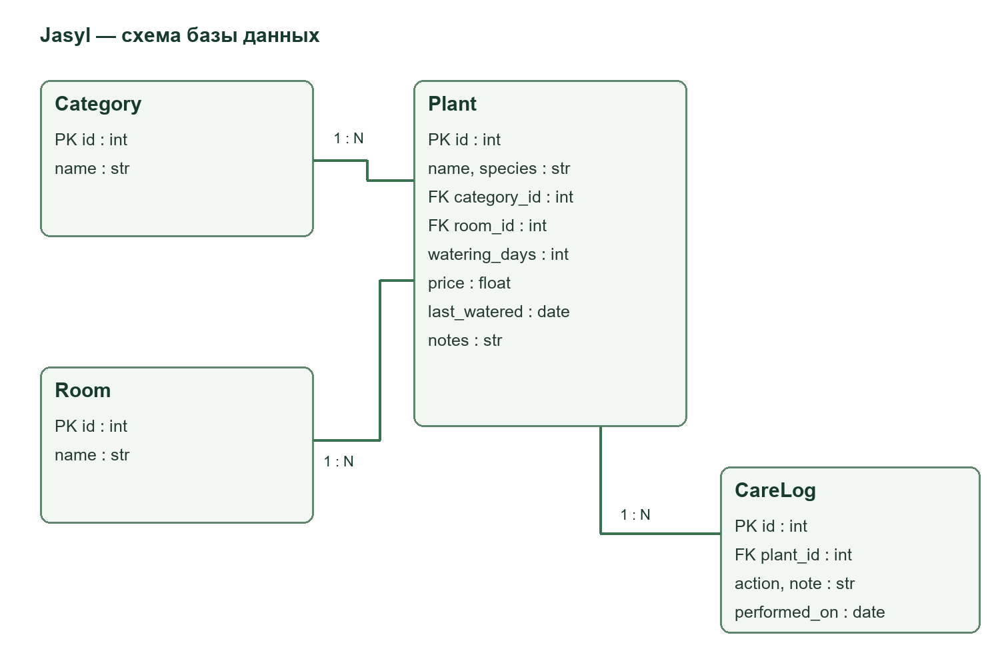

# Информационная система Jasyl

**Курс:** Прикладное программное обеспечение информационных систем, 2026 г.

**Автор:** Нұрсая Жұматай, группа ИС 24 а1

[](https://github.com/nursayaya1/applied-is-project-2026-jasyl/actions/workflows/checks.yml)

## Описание предметной области

Jasyl помогает вести домашнюю коллекцию растений. Я могу добавить растение, указать его комнату, категорию и период полива. В журнале сохраняются выполненные действия по уходу. Поиск и фильтры помогают быстро найти нужное растение.

## Архитектура данных



- Category — категория растений, связь один ко многим с Plant.
- Room — комната, связь один ко многим с Plant.
- Plant — растение, связь один ко многим с CareLog.
- CareLog — запись об уходе за растением.

## Технологический стек

Python 3.11+, FastAPI, Uvicorn, SQLite, SQLModel, Streamlit, Requests, Docker Compose, pytest. ИИ-помощник использован для подготовки структуры и проверки кода.

## Локальный запуск

```bash
git clone https://github.com/nursayaya1/applied-is-project-2026-jasyl.git
cd applied-is-project-2026-jasyl
python -m venv .venv
# Windows: .venv\Scripts\activate
# Linux / macOS: source .venv/bin/activate
pip install -r requirements.txt
python -m app.database.seed
uvicorn app.main:app --reload
```

В другом терминале с активным окружением:

```bash
streamlit run app/frontend/ui.py
```

Интерфейс: http://localhost:8501. Swagger: http://localhost:8000/docs.

## Запуск в Docker

```bash
docker compose up --build
```

Данные сохраняются в томе `jasyl_data`. Команда `docker compose down` не удаляет этот том.

## Тестирование

```bash
python -m pytest -q
```

Тесты используют отдельную базу в памяти и не изменяют коллекцию.

## Интерфейс


Доступны обзор, коллекция с карточками и таблицей, поиск и фильтры, добавление и редактирование, удаление с подтверждением, календарь и журнал ухода, экспорт CSV.

## Документация

- [План недель](docs/requirements.md)
- [Результаты проверки](docs/review.md)
- Word-отчёты расположены в `reports/`.

## Публикация

Основной вариант — Docker Compose. Для Streamlit Community Cloud подготовлен `streamlit_app.py`: он запускает тот же FastAPI на внутреннем порту и открывает тот же интерфейс. В настройках публикации выбираются этот репозиторий, ветка `main` и файл `streamlit_app.py`.

Публичная версия предназначена для демонстрационных данных: авторизация пока не предусмотрена, а локальная SQLite на Community Cloud не гарантирует сохранение после перезапуска. В Docker данные сохраняются в томе.

На компьютере автора для проверки использовались свободные порты 8010 и 8510, так как стандартные порты были заняты другим проектом.
